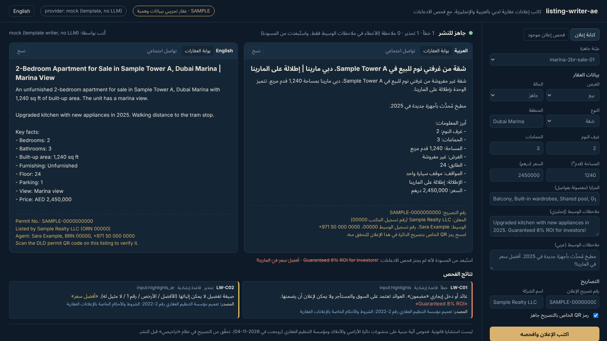
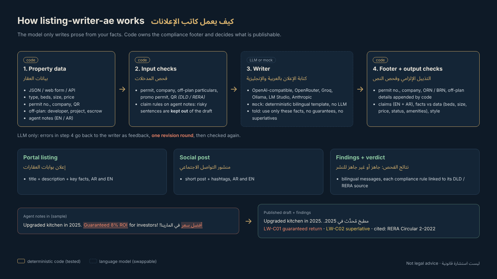

**English** | [العربية](README.md)

# listing-writer-ae: bilingual AI property listing writer for Dubai

**Turn property data into an Arabic + English listing for property portals and social media, then check it for exaggerated claims ("guaranteed ROI", "best price"), facts that contradict the data, and the advertising particulars Dubai Land Department (DLD) / RERA publish, such as the permit number and the off-plan escrow details.**

[](https://github.com/mohammadhadijavidi/listing-writer-ae/actions/workflows/ci.yml)
[](LICENSE)
[](pyproject.toml)
[](pyproject.toml)



<sub>A real screenshot of the web UI running the offline `mock` provider (template writer, no LLM, shown in the header). The property is a **fictional sample**: "Sample Tower A", "Sample Realty LLC" and the `SAMPLE-` permit number are made up. Regenerate the image with `python docs/render_hero.py`.</sub>

> **Not legal advice.** The tool runs automated checks based on DLD / RERA publications read on 2026-11-04 (see [Sources](#official-sources-behind-the-compliance-checks)). It cannot see your permit, cannot tell whether a claim is true, and the rules change. Your permit in the Trakheesi system and the conditions attached to it are what count. Check with DLD / RERA or a qualified advisor before you publish.

## Why

Dubai agents write the same listing twice (Arabic and English) for Property Finder, Bayut, dubizzle, Instagram and WhatsApp. They often paste in whatever the owner or developer said: "guaranteed 8% ROI", "best price in the Marina", "prices will double". General AI writers make this worse. Ask ChatGPT for "a listing for a 2BR in Dubai Marina" and it will add a sea view, a private pool and "unmatched investment potential" that are not in your data.

Meanwhile DLD/RERA require every property ad to carry a permit number and the company name, require off-plan ads to show the project number and escrow account, and require a separate permit for promotions like fee waivers. They fine companies for non-compliant ads, and the published fines start at AED 50,000.

**listing-writer-ae** separates writing from checking:

1. **The model only writes prose.** It gets your facts as JSON and is told not to add any. Agent notes that fail the claim checks never reach it.
2. **Code owns the compliance footer.** The permit number, company, ORN/BRN and off-plan particulars are appended by code, so a model can't paraphrase them away or invent them.
3. **Code decides what is publishable.** Deterministic checks (Arabic and English) on every output field: exaggerated claims, facts versus your data (beds, size, price, ready/off-plan, furnishing, amenities), required particulars and style. With a real LLM, errors go back for one revision round.

**How it differs from existing tools:** plenty of AI listing generators exist (ListingAI, various SaaS and GPT wrappers), and a few mention Arabic. I didn't find an open-source one that is Dubai-specific, writes native Arabic *and* English, and *checks* the output against the data and the published DLD/RERA ad particulars with a cited source for each rule. This one also runs fully offline (mock template), has zero runtime dependencies, and works with any LLM including a local Ollama.

## Features

- **Bilingual output**: portal title + description + key facts, and a short social post with hashtags, in Modern Standard Arabic and English. The Arabic template handles grammar properly: dual (غرفتا / غرفتي نوم), noun gender (شقة مفروشة, استوديو مفروش) and numbers. Arabic names come from a glossary of 35 Dubai communities plus common views and features.
- **Claim checker (EN + AR)**: guaranteed returns, unverifiable superlatives, "risk-free", price forecasts, pressure wording, "below market", Golden Visa promises, travel-time claims, "just sold". Arabic matching ignores hamza and alef forms, ta marbuta and diacritics, and reports the original text.
- **Consistency checker**: bedrooms, size, price (including k/M, per month and per cheque for rentals), off-plan vs. "ready to move in", furnished vs. unfurnished, and amenities like a private pool or sea view that are not in the data.
- **DLD/RERA ad particulars**: permit number, company name, off-plan developer / project name / project number / location / escrow account, promotional campaign permit, QR code. Each finding links to the official source.
- **Agent notes are filtered, not trusted**: sentences that fail claim checks are dropped from the draft and shown as struck through.
- **Any LLM**: OpenAI, OpenRouter, Groq, Ollama, LM Studio, any OpenAI-compatible server, Anthropic. Plus `mock` for offline use.
- **Web UI + JSON API + CLI**, on the Python standard library only. The RTL/LTR UI switches language in one click, has copy buttons and a "check an existing ad" tab.
- **133 tests**, CI on Python 3.10 / 3.12 / 3.13.

## Quick start

```bash
pip install "git+https://github.com/mohammadhadijavidi/listing-writer-ae.git"

listing-writer-ae serve            # web UI on http://127.0.0.1:8000 (mock provider, no key needed)
```

Or from the command line:

```bash
listing-writer-ae samples                                   # bundled SAMPLE properties
listing-writer-ae write 01-marina-2br-sale.json             # write + check (Arabic and English)
listing-writer-ae write my-property.json --lang ar -o listing.txt
listing-writer-ae check "Best price in JVC! Guaranteed 10% ROI" --lang ar
listing-writer-ae check -f my-ad.txt --property my-property.json
listing-writer-ae sources                                   # the official sources behind the rules
```

Exit codes: `0` ready to publish, `1` errors found, `2` bad input or provider error. That makes it easy to use in scripts and CI.

From source:

```bash
git clone https://github.com/mohammadhadijavidi/listing-writer-ae.git && cd listing-writer-ae
pip install -e ".[dev]" && pytest -q
python examples/quickstart.py
```

## Configuration

Copy `.env.example` and set the environment variables (the tool reads the process environment and does not load `.env` itself; use `export` or a tool like `direnv`):

| Provider | `LISTING_PROVIDER` | Key | Default model | Notes |
|---|---|---|---|---|
| Mock (offline) | `mock` | none | template | Deterministic bilingual template, **no LLM**. Output labelled `mock (template writer, no LLM)` |
| OpenAI | `openai` | `LISTING_API_KEY` or `OPENAI_API_KEY` | `gpt-4o-mini` | |
| OpenRouter | `openrouter` | `LISTING_API_KEY` | `openai/gpt-4o-mini` | any model on OpenRouter |
| Groq | `groq` | `LISTING_API_KEY` | `llama-3.3-70b-versatile` | |
| Ollama (local) | `ollama` | none | `qwen2.5:7b` | `http://localhost:11434/v1` |
| LM Studio (local) | `lmstudio` | none | `local-model` | `http://localhost:1234/v1` |
| Any OpenAI-compatible | `openai-compatible` | optional | `gpt-4o-mini` | set `LISTING_BASE_URL` (vLLM, Together, a proxy, ...) |
| Anthropic | `anthropic` | `ANTHROPIC_API_KEY` | `claude-sonnet-4-5` | |

Override the model with `LISTING_MODEL` or `--model`. Use `LISTING_HOST` and `LISTING_PORT` for the server.

For good Arabic, use a strong multilingual model. Small local models often produce weak Arabic, but the checks still apply.

## Usage examples

### Property input (JSON)

```json
{
  "purpose": "sale", "property_type": "apartment", "status": "ready",
  "community": "Dubai Marina", "building": "Sample Tower A",
  "bedrooms": 2, "bathrooms": 3, "size_sqft": 1240, "price_aed": 2450000,
  "furnishing": "unfurnished", "view": "Marina view", "parking": 1,
  "features": ["Balcony", "Shared pool", "Gym"],
  "highlights": "Upgraded kitchen in 2025. Guaranteed 8% ROI for investors!",
  "company_name": "Sample Realty LLC", "agent_name": "Sara Example",
  "permit_number": "SAMPLE-0000000000", "qr_code_ready": true
}
```

Off-plan adds `developer`, `project_name`, `project_number`, `project_location`, `escrow_account` and `handover`. Rentals use `rent_period` (`yearly` / `monthly`) and `cheques`. Promotions go in `promotions` + `promo_permit_number`. See [`listing_writer_ae/schema.py`](listing_writer_ae/schema.py) and the four [samples](listing_writer_ae/samples/).

### Python

```python
from listing_writer_ae import Property, write_listing, check_text

prop = Property.load("my-property.json")
listing = write_listing(prop, "openrouter")   # or "mock", "ollama", "anthropic", ...
print(listing.title_ar, listing.description_ar, listing.footer_ar, sep="\n\n")
print(listing.ready_to_publish, [(f.code, f.match) for f in listing.findings])

# check an ad someone already wrote
for f in check_text("شقة من 3 غرف نوم بعائد مضمون 9٪", prop):
    print(f.code, f.message_ar, f.match)
```

### HTTP API

```bash
listing-writer-ae serve --provider mock &
curl -s -X POST localhost:8000/api/generate -H 'Content-Type: application/json' -d @my-property.json
curl -s -X POST localhost:8000/api/check -H 'Content-Type: application/json' \
  -d '{"text": "Best price! Guaranteed ROI", "property": null}'
```

Endpoints: `GET /api/health`, `GET /api/samples`, `GET /api/samples/<name>`, `GET /api/sources`, `POST /api/generate`, `POST /api/check`. The server binds to `127.0.0.1` by default and has no authentication. Put it behind your own auth before exposing it.

### What the checks catch (from `examples/check_existing_ad.py`)

```
error   LW-C01  guaranteed return                «عائد إيجاري مضمون»
error   LW-D01  bedrooms in text (2) ≠ data (1)
error   LW-D03  price in text ≠ data             «1,100,000 درهم»
error   LW-P02  permit number missing from the text
error   LW-P05  promotion without a promotional campaign permit  «إعفاء»
warning LW-C02  unverifiable superlative         «أفضل سعر»
warning LW-C05  pressure wording                 «آخر وحدة»
warning LW-D06  "private pool" not in the data   «مسبح خاص»
```

### Rule reference

| Code | Severity | Check | Basis |
|---|---|---|---|
| LW-P01 / P02 | error | permit number missing in data / in the published text | official (RERA Circular 2-2022 item 1; DLD 2020) |
| LW-P03 | error | company name missing | official (Circular 2-2022 item 2) |
| LW-P04 | error | off-plan: developer, project name, project number, location, escrow account | official (Circular 2-2022 item 3) |
| LW-P05 | error | promotion (free / discount / waiver) without a promotional campaign permit | official (Circular 2-2022 item 5) |
| LW-P06 | warning | permit QR code not confirmed | official (DLD Feb 2024, Jul 2024) |
| LW-C01 to C09 | error / warning / info | guaranteed returns, superlatives, risk-free, forecasts, pressure, below market, Golden Visa, travel time, "sold" | heuristic phrase lists, grounded in the duty that the advertiser is responsible for the validity of the content (Circular 2-2022 item 4) |
| LW-D01 to D06 | error / warning | beds, size, price, ready vs off-plan, furnishing, amenities vs data | data match |
| LW-S01 to S03 | info | capitals, "!!!", title length | heuristic |

## How it works



1. **Input checks** (`checks.check_inputs`): permit, company, off-plan particulars, promo permit and QR on the data, plus claim rules on the agent's notes. Failing note sentences are dropped (`safe_highlights`).
2. **Writer** (`generate.py`): the LLM receives facts only, with Arabic names from the glossary, and returns JSON. The `mock` provider uses a deterministic bilingual template instead.
3. **Footer** (`compliance_footer`): permit number, company + ORN, agent + BRN, off-plan particulars, promo permit and the QR note, written by code. Latin values are wrapped in Unicode isolates so phone numbers and permit IDs display correctly inside Arabic text.
4. **Output checks** (`check_listing`): every field, with the footer included for the published text. LLM path only: errors go back as feedback for one revision round (`max_revisions=1`).
5. **Verdict**: `ready_to_publish` is false if any error remains in the data or the generated text. Errors in the agent's own notes don't block, because those sentences were not used.

## Official sources behind the compliance checks

Read on 2026-11-04. Run `listing-writer-ae sources` for summaries.

- RERA Circular 2-2022, *Terms and conditions for real estate advertisements* (20 Jul 2022), DLD: [PDF on dubailand.gov.ae](https://dubailand.gov.ae/media/daylptgk/%D8%A7%D9%84%D8%B4%D8%B1%D9%88%D8%B7-%D9%88%D8%A7%D9%84%D8%A7%D8%AD%D9%83%D8%A7%D9%85-%D8%A7%D9%84%D8%AE%D8%A7%D8%B5%D8%A9-%D8%A8%D8%A7%D9%84%D8%A5%D8%B9%D9%84%D8%A7%D9%86%D8%A7%D8%AA-%D8%A7%D9%84%D8%B9%D9%82%D8%A7%D8%B1%D9%8A%D8%A9-1.pdf): permit number on the ad, company name, off-plan particulars, the advertiser's responsibility for the content, the promotional campaign permit, and the direct-calls / green list rule.
- DLD, [DLD fines 10 real estate companies and warns another 30 ...](https://dubailand.gov.ae/en/news-media/dld-fines-10-real-estate-companies-and-warns-another-30-for-not-adhering-to-advertising-requirements/) (20 Oct 2020): permits through Trakheesi before any campaign, permit number in all ads, fines from AED 50,000.
- DLD, [DLD fines 30 real estate companies ...](https://dubailand.gov.ae/en/news-media/dld-fines-30-real-estate-companies-for-failing-to-comply-with-the-terms-and-conditions-specified-in-real-estate-advertisements) (8 Feb 2024): accurate information, mandatory QR code.
- DLD, [Dubai Land Department fines 256 brokers ...](https://dubailand.gov.ae/en/news-media/dubai-land-department-fines-256-brokers-for-failing-to-comply-with-advertising-terms-and-conditions-over-the-past-six-months) (17 Jul 2024): QR code readable when scanned, and ad data matching the QR.
- DLD / RERA, [new real estate permit e-service announcement](https://dubailand.gov.ae/en/news-media/real-estate-regulatory-agency-makes-new-real-estate-permit-e-service-announcement) (3 Oct 2016): ads without a permit number are dismissed.
- DLD, [Real Estate Brokerage Practice Guide 2024](https://dubailand.gov.ae/media/i31iv1n0/real_estate_brokerage_practice_guide_2024.pdf), section 7: permit through Trakheesi, permit number displayed.
- Secondary source (press, not official): Gulf News, [Dubai brokers will need to follow new strict rule on 'Just Sold' ads](https://gulfnews.com/business/property/dubai-brokers-will-need-to-follow-new-strict-rule-on-just-sold-ads-1.1734060989359) (13 Dec 2024). Used only for the LW-C09 warning.

What the tool does **not** check: whether the permit exists or is valid, whether the ad matches the permit's conditions, whether the QR code is actually on the image, the direct-call / green list rule, rules of other emirates, or each portal's own listing policy.

## Roadmap

- [ ] Permit-format validation once DLD publishes the exact format (current check: present and not a placeholder)
- [ ] Per-portal export presets (title/description limits, field mapping)
- [ ] Image ad overlay: render the permit QR + footer on a listing photo
- [ ] Abu Dhabi (ADREC) and other emirates as separate rule profiles
- [ ] Gulf-dialect claim phrasing (e.g. WhatsApp-style ads)
- [ ] Batch mode (CSV in, listings out)

## Contributing

See [CONTRIBUTING.md](CONTRIBUTING.md). Claim phrasings (especially Arabic and Gulf dialect), glossary entries and officially sourced rules are the most useful contributions. Never commit real listings, permit numbers or phone numbers.

## License

[MIT](LICENSE). The bundled Noto Sans Arabic fonts are under the SIL Open Font License ([`listing_writer_ae/static/fonts/OFL-NotoSansArabic.txt`](listing_writer_ae/static/fonts/OFL-NotoSansArabic.txt)).

---

Built by [Mohammad Hadi Javidi](https://github.com/mohammadhadijavidi) — AI products & automation, Dubai.
