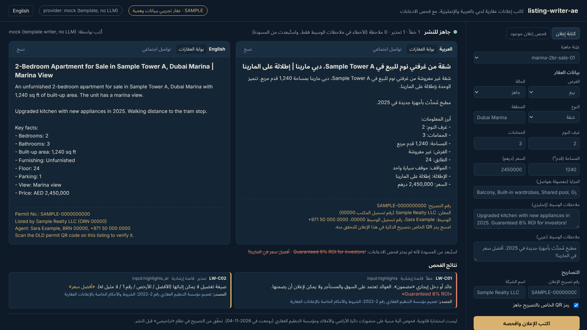
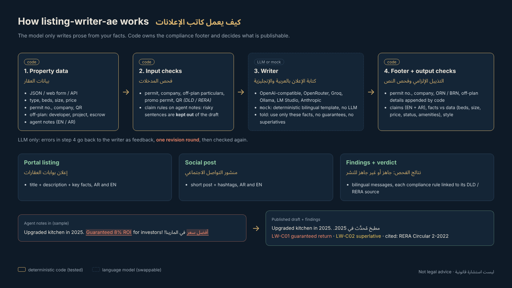

<div dir="rtl">

[English](README.en.md) | **العربية**

# listing-writer-ae: كاتب إعلانات عقارية لدبي بالذكاء الاصطناعي، بالعربية والإنجليزية

**حوّل بيانات العقار إلى إعلان جاهز بالعربية والإنجليزية لبوابات العقارات ووسائل التواصل الاجتماعي، ثم افحصه آلياً. تكشف الأداة الادعاءات المبالغ فيها (مثل «عائد مضمون» و«أفضل سعر»)، والمعلومات التي تخالف بيانات العقار، والبيانات التي تشترطها دائرة الأراضي والأملاك في دبي ومؤسسة التنظيم العقاري (RERA) في الإعلان، مثل رقم التصريح وبيانات حساب الضمان في مشاريع البيع على المخطط.**

[](https://github.com/mohammadhadijavidi/listing-writer-ae/actions/workflows/ci.yml)
[](LICENSE)
[](pyproject.toml)
[](pyproject.toml)



<sub>لقطة حقيقية من الواجهة تعمل بالمزوّد التجريبي `mock`، أي قالب كتابة ثابت دون نموذج لغوي، كما يظهر أعلى الواجهة. العقار **عيّنة وهمية**: «Sample Tower A» و«Sample Realty LLC» ورقم التصريح الذي يبدأ بـ `SAMPLE-` كلها مختلقة. يمكنك إعادة توليد الصورة بالأمر `python docs/render_hero.py`.</sub>

> **تنبيه: هذه ليست استشارة قانونية.** الأداة تجري فحوصاً آلية مبنية على منشورات دائرة الأراضي والأملاك ومؤسسة التنظيم العقاري التي راجعتُها بتاريخ 2026-11-04 (انظر قسم [المصادر الرسمية](#المصادر-الرسمية-لفحوص-الامتثال)). لا تستطيع الأداة الاطلاع على تصريحك، ولا معرفة صحة الادعاء من عدمها، والقواعد قد تتغيّر. المرجع هو تصريحك في نظام «تراخيصي» والشروط المرتبطة به. راجع الدائرة أو مستشاراً مؤهلاً قبل النشر.

## لماذا هذا المشروع؟

الوسيط العقاري في دبي يكتب الإعلان نفسه مرتين، بالعربية والإنجليزية، لبوابات مثل Property Finder وBayut وdubizzle، ولإنستغرام وواتساب. وكثيراً ما ينسخ كلام المالك أو المطوّر كما هو: «عائد مضمون 8٪»، «أفضل سعر في المارينا»، «الأسعار ستتضاعف». وأدوات الكتابة بالذكاء الاصطناعي العامة تزيد المشكلة. اطلب من ChatGPT «إعلاناً لشقة من غرفتي نوم في دبي مارينا» وسيضيف إطلالة على البحر ومسبحاً خاصاً و«فرصة استثمارية لا مثيل لها»، وكلها غير موجودة في بياناتك.

في المقابل، تشترط الدائرة ومؤسسة التنظيم العقاري أن يحمل كل إعلان عقاري رقم التصريح واسم الشركة. وتشترط أن يذكر إعلان البيع على المخطط رقم المشروع وحساب الضمان، وأن يكون للعروض الترويجية، مثل الإعفاء من الرسوم، تصريح مستقل. وتفرض الدائرة غرامات على الإعلانات المخالفة تبدأ، بحسب ما نشرته، من 50,000 درهم.

**listing-writer-ae** يفصل الكتابة عن الفحص:

1. **النموذج يكتب النص فقط.** يتلقى بياناتك بصيغة JSON، ويُطلب منه ألا يضيف أي معلومة. أما ملاحظات الوسيط التي لا تجتاز فحص الادعاءات فلا تصل إليه أصلاً.
2. **الكود يكتب التذييل الإلزامي.** رقم التصريح واسم الشركة ورقم تسجيل المكتب (ORN) ورقم تسجيل الوسيط (BRN) وبيانات البيع على المخطط يضيفها الكود. لذلك لا يستطيع النموذج تحريفها أو اختلاقها.
3. **الكود يقرّر ما يصلح للنشر.** فحوص حتمية بالعربية والإنجليزية على كل حقل من الناتج: الادعاءات المبالغ فيها، ومطابقة النص لبياناتك (عدد الغرف والمساحة والسعر وحالة العقار والفرش والمزايا)، والبيانات الإلزامية، والأسلوب. وعند استخدام نموذج لغوي حقيقي، تُعاد الأخطاء إليه لجولة تصحيح واحدة.

**ما الذي يميّزه عن الأدوات الموجودة؟** هناك أدوات كثيرة لتوليد الإعلانات العقارية بالذكاء الاصطناعي (مثل ListingAI وأدوات SaaS وواجهات مبنية على GPT)، وبعضها يذكر العربية. لكني لم أجد أداة مفتوحة المصدر مخصّصة لدبي تكتب بالعربية الأصيلة والإنجليزية معاً، ثم *تفحص* الناتج مقابل البيانات ومقابل اشتراطات الدائرة المنشورة، مع ذكر مصدر لكل قاعدة. وهذه الأداة تعمل أيضاً دون إنترنت (بالقالب التجريبي)، وبلا أي اعتماديات وقت التشغيل، ومع أي نموذج لغوي، بما في ذلك Ollama على جهازك.

## المزايا

- **ناتج ثنائي اللغة**: عنوان ووصف وأبرز المعلومات لبوابات العقارات، ومنشور قصير مع وسوم للتواصل الاجتماعي، بالعربية الفصحى والإنجليزية. والقالب العربي يراعي قواعد اللغة: المثنى (غرفتا نوم / من غرفتي نوم)، وتذكير الصفة وتأنيثها (شقة مفروشة، استوديو مفروش)، وتمييز العدد. أسماء المناطق والإطلالات والمزايا بالعربية تأتي من قاموس يضم 35 منطقة في دبي إلى جانب الإطلالات والمزايا الشائعة.
- **فحص الادعاءات بالعربية والإنجليزية**: العوائد المضمونة، وصيغ التفضيل التي لا يمكن إثباتها، و«بدون مخاطر»، وتوقّعات الأسعار، وعبارات الضغط («سارع»، «آخر وحدة»)، و«أقل من سعر السوق»، ووعود الإقامة الذهبية، ومدة الوصول، و«تم البيع». المطابقة العربية لا تتأثر بأشكال الهمزة والألف ولا بالتاء المربوطة ولا بالتشكيل، وتعرض لك النص الأصلي كما كُتب.
- **فحص التطابق مع البيانات**: عدد الغرف، والمساحة، والسعر (مع دعم صيغ مثل 2.2M و60k، والإيجار الشهري وقيمة الشيك الواحد)، و«جاهز للسكن» في عقار على المخطط، و«مفروشة» في عقار غير مفروش، والمزايا غير الموجودة في البيانات مثل المسبح الخاص أو الإطلالة على البحر.
- **بيانات الإعلان الإلزامية**: رقم التصريح، واسم الشركة، وفي البيع على المخطط: المطوّر واسم المشروع ورقمه وموقعه وحساب الضمان. وكذلك تصريح الحملة الترويجية ورمز QR. وكل ملاحظة مرتبطة بمصدرها الرسمي.
- **ملاحظات الوسيط تُفلتر ولا تُعتمد كما هي**: الجمل التي لا تجتاز فحص الادعاءات تُستبعد من المسودة وتظهر مشطوبة.
- **أي نموذج لغوي**: OpenAI وOpenRouter وGroq وOllama وLM Studio وأي خادم متوافق مع OpenAI، إضافة إلى Anthropic، ومزوّد `mock` للعمل دون إنترنت.
- **واجهة ويب وواجهة JSON API وسطر أوامر**، كلها على مكتبة بايثون القياسية فقط. الواجهة تدعم الاتجاهين، وتبدّل اللغة بنقرة، وفيها أزرار نسخ وتبويب «فحص إعلان موجود».
- **133 اختباراً**، وتكامل مستمر على بايثون 3.10 و3.12 و3.13.

## البدء السريع

```bash
pip install "git+https://github.com/mohammadhadijavidi/listing-writer-ae.git"

listing-writer-ae serve            # الواجهة على http://127.0.0.1:8000 بالمزوّد التجريبي، دون مفتاح
```

أو من سطر الأوامر:

```bash
listing-writer-ae samples                                   # العقارات التجريبية المرفقة
listing-writer-ae write 01-marina-2br-sale.json             # كتابة وفحص بالعربية والإنجليزية
listing-writer-ae write my-property.json --lang ar -o listing.txt
listing-writer-ae check "أفضل سعر في المنطقة! عائد مضمون 10٪" --lang ar
listing-writer-ae check -f my-ad.txt --property my-property.json
listing-writer-ae sources                                   # المصادر الرسمية للقواعد
```

رموز الخروج: `0` جاهز للنشر، و`1` توجد أخطاء، و`2` مدخلات غير صالحة أو خطأ في المزوّد. وهذا يسهّل استخدام الأداة في السكربتات والتكامل المستمر.

من الشيفرة المصدرية:

```bash
git clone https://github.com/mohammadhadijavidi/listing-writer-ae.git && cd listing-writer-ae
pip install -e ".[dev]" && pytest -q
python examples/quickstart.py
```

## الإعدادات

انسخ `.env.example` واضبط متغيرات البيئة. الأداة تقرأ متغيرات البيئة مباشرة ولا تحمّل ملف `.env` بنفسها، فاستخدم `export` أو أداة مثل `direnv`.

| المزوّد | `LISTING_PROVIDER` | المفتاح | النموذج الافتراضي | ملاحظات |
|---|---|---|---|---|
| تجريبي دون إنترنت | `mock` | لا يلزم | قالب | قالب ثنائي اللغة ثابت، **دون نموذج لغوي**. الناتج موسوم بـ `mock (template writer, no LLM)` |
| OpenAI | `openai` | `LISTING_API_KEY` أو `OPENAI_API_KEY` | `gpt-4o-mini` | |
| OpenRouter | `openrouter` | `LISTING_API_KEY` | `openai/gpt-4o-mini` | أي نموذج على OpenRouter |
| Groq | `groq` | `LISTING_API_KEY` | `llama-3.3-70b-versatile` | |
| Ollama محلياً | `ollama` | لا يلزم | `qwen2.5:7b` | `http://localhost:11434/v1` |
| LM Studio محلياً | `lmstudio` | لا يلزم | `local-model` | `http://localhost:1234/v1` |
| أي خادم متوافق مع OpenAI | `openai-compatible` | اختياري | `gpt-4o-mini` | اضبط `LISTING_BASE_URL` (مثل vLLM أو Together أو وسيط) |
| Anthropic | `anthropic` | `ANTHROPIC_API_KEY` | `claude-sonnet-4-5` | |

غيّر النموذج عبر `LISTING_MODEL` أو `--model`. وللخادم استخدم `LISTING_HOST` و`LISTING_PORT`.

للحصول على عربية جيدة، استخدم نموذجاً قوياً متعدد اللغات. النماذج المحلية الصغيرة كثيراً ما تكتب عربية ضعيفة، لكن الفحوص تبقى سارية عليها.

## أمثلة الاستخدام

### بيانات العقار (JSON)

```json
{
  "purpose": "sale", "property_type": "apartment", "status": "ready",
  "community": "Dubai Marina", "building": "Sample Tower A",
  "bedrooms": 2, "bathrooms": 3, "size_sqft": 1240, "price_aed": 2450000,
  "furnishing": "unfurnished", "view": "Marina view", "parking": 1,
  "features": ["Balcony", "Shared pool", "Gym"],
  "highlights_ar": "مطبخ مُحدَّث في 2025. أفضل سعر في المارينا!",
  "company_name": "Sample Realty LLC", "agent_name": "Sara Example",
  "permit_number": "SAMPLE-0000000000", "qr_code_ready": true
}
```

لعقار على المخطط أضف `developer` و`project_name` و`project_number` و`project_location` و`escrow_account` و`handover`. وللإيجار استخدم `rent_period` (`yearly` أو `monthly`) و`cheques`. وتوضع العروض الترويجية في `promotions` مع `promo_permit_number`. ويمكنك تمرير أسماء عربية مخصّصة عبر `community_ar` و`view_ar` و`features_ar`. التفاصيل في [`listing_writer_ae/schema.py`](listing_writer_ae/schema.py) وفي [العيّنات الأربع](listing_writer_ae/samples/).

### بايثون

```python
from listing_writer_ae import Property, write_listing, check_text

prop = Property.load("my-property.json")
listing = write_listing(prop, "openrouter")   # أو "mock" أو "ollama" أو "anthropic" ...
print(listing.title_ar, listing.description_ar, listing.footer_ar, sep="\n\n")
print(listing.ready_to_publish, [(f.code, f.match) for f in listing.findings])

# فحص إعلان مكتوب مسبقاً
for f in check_text("شقة من 3 غرف نوم بعائد مضمون 9٪", prop):
    print(f.code, f.message_ar, f.match)
```

### واجهة HTTP

```bash
listing-writer-ae serve --provider mock &
curl -s -X POST localhost:8000/api/generate -H 'Content-Type: application/json' -d @my-property.json
curl -s -X POST localhost:8000/api/check -H 'Content-Type: application/json' \
  -d '{"text": "أفضل سعر! عائد مضمون", "property": null}'
```

نقاط الوصول: `GET /api/health` و`GET /api/samples` و`GET /api/samples/<name>` و`GET /api/sources` و`POST /api/generate` و`POST /api/check`. الخادم يستمع افتراضياً على `127.0.0.1` ولا يتضمن مصادقة، فضعه خلف نظام مصادقة خاص بك قبل إتاحته للآخرين.

### ما الذي تكشفه الفحوص (من `examples/check_existing_ad.py`)

</div>

```
error   LW-C01  عائد أو دخل إيجاري «مضمون»                        «عائد إيجاري مضمون»
error   LW-D01  عدد غرف النوم في النص (2) يخالف بيانات العقار (1)
error   LW-D03  السعر في النص يختلف عن بيانات العقار               «1,100,000 درهم»
error   LW-P02  رقم التصريح غير موجود في هذا النص
error   LW-P05  عرض ترويجي دون تصريح حملة ترويجية                  «إعفاء»
warning LW-C02  صيغة تفضيل لا يمكن إثباتها                          «أفضل سعر»
warning LW-C05  عبارات ضغط أو ندرة                                  «آخر وحدة»
warning LW-D06  «مسبح خاص» غير موجود في بيانات العقار
```

<div dir="rtl">

### مرجع القواعد

| الرمز | الخطورة | ما يُفحص | الأساس |
|---|---|---|---|
| LW-P01 / P02 | خطأ | رقم التصريح غير موجود في البيانات / في النص المنشور | رسمي (تعميم 2-2022 البند 1، والدائرة 2020) |
| LW-P03 | خطأ | اسم الشركة غير موجود | رسمي (تعميم 2-2022 البند 2) |
| LW-P04 | خطأ | على المخطط: المطوّر واسم المشروع ورقمه وموقعه وحساب الضمان | رسمي (تعميم 2-2022 البند 3) |
| LW-P05 | خطأ | عرض ترويجي (مجاني / خصم / إعفاء) دون تصريح حملة ترويجية | رسمي (تعميم 2-2022 البند 5) |
| LW-P06 | تحذير | رمز QR الخاص بالتصريح غير مؤكَّد | رسمي (الدائرة، فبراير 2024 ويوليو 2024) |
| LW-C01 إلى C09 | خطأ / تحذير / ملاحظة | العوائد المضمونة، صيغ التفضيل، انعدام المخاطر، التوقّعات، عبارات الضغط، أقل من سعر السوق، الإقامة الذهبية، مدة الوصول، «تم البيع» | قوائم عبارات إرشادية، مستندة إلى مسؤولية المعلن عن صحة المحتوى (تعميم 2-2022 البند 4) |
| LW-D01 إلى D06 | خطأ / تحذير | الغرف، المساحة، السعر، جاهز أم على المخطط، الفرش، المزايا مقابل البيانات | مطابقة البيانات |
| LW-S01 إلى S03 | ملاحظة | الأحرف الكبيرة، «!!!»، طول العنوان | إرشادي |

## كيف يعمل



1. **فحص المدخلات** (`checks.check_inputs`): التصريح والشركة وبيانات البيع على المخطط وتصريح العرض الترويجي ورمز QR في البيانات، إضافة إلى قواعد الادعاءات على ملاحظات الوسيط. الجمل المخالفة تُستبعد (`safe_highlights`).
2. **الكتابة** (`generate.py`): يتلقى النموذج اللغوي الحقائق فقط، مع الأسماء العربية من القاموس، ويعيد JSON. أما مزوّد `mock` فيستخدم قالباً ثنائي اللغة ثابتاً.
3. **التذييل** (`compliance_footer`): رقم التصريح، والشركة مع رقم تسجيل المكتب، والوسيط مع رقم تسجيله، وبيانات البيع على المخطط، وتصريح العرض، وملاحظة رمز QR. يكتبها الكود، ويعزل القيم اللاتينية بمحارف العزل في يونيكود حتى تظهر أرقام الهواتف والتصاريح بالترتيب الصحيح داخل النص العربي.
4. **فحص الناتج** (`check_listing`): كل حقل، مع التذييل بوصفه جزءاً من النص المنشور. وفي حالة النموذج اللغوي فقط، تُعاد الأخطاء إليه لجولة تصحيح واحدة (`max_revisions=1`).
5. **الحكم**: تكون قيمة `ready_to_publish` خطأً (false) إذا بقي أي خطأ في البيانات أو في النص المولَّد. أما الأخطاء في ملاحظات الوسيط نفسها فلا تمنع النشر، لأن تلك الجمل لم تُستخدم.

## المصادر الرسمية لفحوص الامتثال

راجعتُها بتاريخ 2026-11-04. لعرض ملخصاتها شغّل `listing-writer-ae sources`.

- تعميم مؤسسة التنظيم العقاري رقم 2-2022 بشأن الشروط والأحكام الخاصة بالإعلانات العقارية (20 يوليو 2022)، دائرة الأراضي والأملاك: [ملف PDF على موقع الدائرة](https://dubailand.gov.ae/media/daylptgk/%D8%A7%D9%84%D8%B4%D8%B1%D9%88%D8%B7-%D9%88%D8%A7%D9%84%D8%A7%D8%AD%D9%83%D8%A7%D9%85-%D8%A7%D9%84%D8%AE%D8%A7%D8%B5%D8%A9-%D8%A8%D8%A7%D9%84%D8%A5%D8%B9%D9%84%D8%A7%D9%86%D8%A7%D8%AA-%D8%A7%D9%84%D8%B9%D9%82%D8%A7%D8%B1%D9%8A%D8%A9-1.pdf). يتناول: رقم التصريح في الإعلان، واسم الشركة، وبيانات البيع على المخطط، ومسؤولية المعلن عن المحتوى، وتصريح الحملة الترويجية، وحظر التسويق بالاتصال المباشر إلا لمن هم في القائمة الخضراء.
- الدائرة: [مخالفة 10 شركات عقارية وإنذار 30 أخرى](https://dubailand.gov.ae/en/news-media/dld-fines-10-real-estate-companies-and-warns-another-30-for-not-adhering-to-advertising-requirements/) (20 أكتوبر 2020). يتناول: استخراج التصاريح عبر «تراخيصي» قبل أي حملة، وإدراج رقم التصريح في جميع الإعلانات، وغرامات تبدأ من 50,000 درهم.
- الدائرة: [مخالفة 30 شركة عقارية](https://dubailand.gov.ae/en/news-media/dld-fines-30-real-estate-companies-for-failing-to-comply-with-the-terms-and-conditions-specified-in-real-estate-advertisements) (8 فبراير 2024). يتناول: دقة المعلومات، وإلزامية رمز QR.
- الدائرة: [مخالفة 256 وسيطاً](https://dubailand.gov.ae/en/news-media/dubai-land-department-fines-256-brokers-for-failing-to-comply-with-advertising-terms-and-conditions-over-the-past-six-months) (17 يوليو 2024). يتناول: أن يكون رمز QR مقروءاً عند المسح، وأن تطابق بيانات الإعلان ما يتضمنه.
- الدائرة ومؤسسة التنظيم العقاري: [إعلان الخدمة الإلكترونية الجديدة لتصاريح الإعلانات](https://dubailand.gov.ae/en/news-media/real-estate-regulatory-agency-makes-new-real-estate-permit-e-service-announcement) (3 أكتوبر 2016). يتناول: رفض الإعلانات التي لا تحمل رقم تصريح.
- الدائرة: [دليل ممارسة مهنة الوساطة العقارية 2024](https://dubailand.gov.ae/media/i31iv1n0/real_estate_brokerage_practice_guide_2024.pdf)، القسم 7. يتناول: استخراج التصريح عبر «تراخيصي»، وإظهار رقمه في الإعلان.
- مصدر ثانوي (صحفي، ليس رسمياً): غلف نيوز، [قاعدة جديدة لإعلانات «تم البيع»](https://gulfnews.com/business/property/dubai-brokers-will-need-to-follow-new-strict-rule-on-just-sold-ads-1.1734060989359) (13 ديسمبر 2024). يُستخدم فقط لتحذير LW-C09.

ما **لا** تفحصه الأداة: وجود التصريح أو صلاحيته، ومطابقة الإعلان لشروط التصريح، ووجود رمز QR فعلاً على الصورة، وقاعدة الاتصال المباشر والقائمة الخضراء، وقواعد الإمارات الأخرى، والسياسات الخاصة بكل بوابة عقارية.

## خارطة الطريق

- [ ] التحقق من صيغة رقم التصريح عندما تنشر الدائرة الصيغة الدقيقة (الفحص الحالي يتأكد من وجوده وأنه ليس قيمة مؤقتة)
- [ ] إعدادات تصدير لكل بوابة عقارية (حدود العنوان والوصف، وربط الحقول)
- [ ] إعلان بصورة: طباعة رمز QR والتذييل على صورة العقار
- [ ] أبوظبي (مركز أبوظبي العقاري ADREC) والإمارات الأخرى كملفات قواعد منفصلة
- [ ] صيغ الادعاءات باللهجة الخليجية (مثل إعلانات واتساب)
- [ ] معالجة دفعات: ملف CSV يدخل، وإعلانات تخرج

## المساهمة

انظر [CONTRIBUTING.md](CONTRIBUTING.md). أكثر المساهمات فائدة: صيغ الادعاءات (خاصة بالعربية واللهجة الخليجية)، ومدخلات القاموس، والقواعد المستندة إلى مصدر رسمي. ولا تضف أبداً إعلانات حقيقية أو أرقام تصاريح أو أرقام هواتف حقيقية.

## الترخيص

[MIT](LICENSE). خطوط Noto Sans Arabic المرفقة مرخّصة برخصة SIL Open Font License ([`listing_writer_ae/static/fonts/OFL-NotoSansArabic.txt`](listing_writer_ae/static/fonts/OFL-NotoSansArabic.txt)).

---

Built by [Mohammad Hadi Javidi](https://github.com/mohammadhadijavidi) — AI products & automation, Dubai.

</div>
